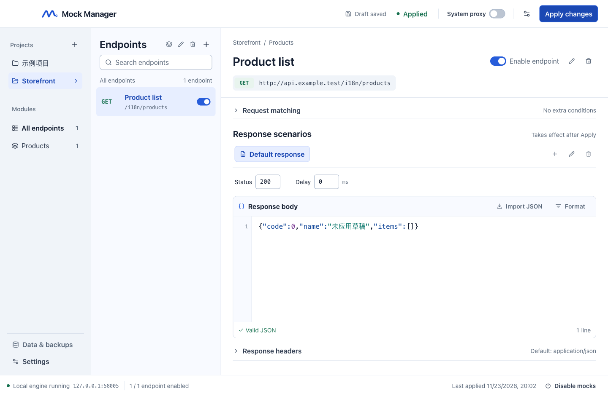
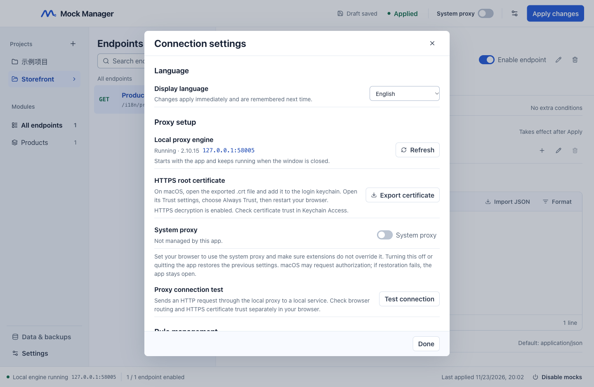

# Mock Manager

[简体中文](README.zh-CN.md) · [Source](https://github.com/Josp3r/mock-manager) · [Issues](https://github.com/Josp3r/mock-manager/issues)

A local desktop API mock manager for frontend development. Keep your original request URLs and switch between success, empty, error, and delayed responses without changing application code.

Mock Manager organizes **projects → endpoints → response scenarios**. A bundled local proxy serves the selected JSON response for matching requests; other requests continue to their original destination. Your browser or application must route requests through that proxy.



*English interface with local test data. Existing project names and JSON content keep their original language when the interface language changes.*

## What it does

- Manage endpoints and multiple response scenarios in one desktop workspace.
- Match the original HTTP/HTTPS URL and method, with optional query/header conditions.
- Configure JSON bodies, status codes, response headers, and delays.
- Enable individual endpoints or restore a project's saved preset.
- Save drafts automatically and apply them explicitly when ready.
- Manage the macOS system proxy and restore its previous settings when disabled or when the app quits.
- Keep projects, drafts, and response bodies in local application storage. No account is required.

The current packaged target is **macOS on Apple Silicon**. A packaged app includes its proxy engine and does not require Node.js, npm, or a separate `w2` installation. See [Build from source](#build-from-source) to create the app.

## First use

1. Open **Mock Manager.app**. Its local engine starts automatically. Open **Settings** to view the engine address and status.
2. For HTTPS requests, select **Export certificate**. On macOS, open the exported `.crt`, add it to the **login** keychain, open its **Trust** settings, and select **Always Trust**. Restart the browser afterward. HTTPS decryption is enabled in the bundled engine; certificate trust is a separate manual step.
3. Turn on **System proxy** in the topbar or Settings. Your browser must use the system proxy; configure proxy extensions accordingly. You can also configure a client manually with the address shown in Settings.
4. Select **Test connection** to verify a local HTTP request through the bundled proxy. This test does not verify browser routing or HTTPS certificate trust.
5. Create a project and an endpoint. Enter the full original URL and HTTP method, then configure response scenarios.
6. Select a scenario, enable the endpoint, and click **Apply changes**. Refresh the page that calls the endpoint.

The initial example uses `api.example.test`, with all endpoints disabled. **Applied** means that the rules were written and verified by reading them back; requests still need to reach the proxy.

For a local ad-hoc signed build, macOS may require you to allow the app under **System Settings → Privacy & Security** or use Finder's **Open** action. These builds are not Apple-notarized. Do not disable system security settings.

## Language

Open **Settings → Language** and choose **System default**, **简体中文**, or **English**. The choice takes effect immediately and is remembered across restarts. System mode uses a supported language from the system's preferred-language list, with English as the fallback.

Language preferences are separate from mock data. Switching the interface language does not rename your projects, endpoints, or scenarios, change JSON content, or apply pending rules. New sample data and default scenario names use the active language when they are created.

<details>
<summary>View language settings</summary>



</details>

## Daily workflow

Edits are saved as drafts. **Apply changes** is what updates proxy responses. Invalid JSON can be kept as a draft but cannot be applied. Disabling or deleting an endpoint also requires Apply. **Disable mocks** stops only the rules managed by this app; it is independent of the system-proxy switch.

A project preset captures endpoint enabled states and selected scenarios. Loading a preset changes the draft and still requires Apply. Backup export includes projects, endpoints, scenarios, and presets. Import creates new IDs and disables imported endpoints; it does not import certificates or system-proxy state.

Closing the macOS window leaves the engine running. Quitting the app with **⌘Q** saves pending drafts, restores the system proxy if the app manages it, and then stops the engine. If restoration is cancelled or conflicts with external changes, the app stays open. Previously applied rules remain available after restarting; turn the system proxy on again when needed.

## Matching and limits

| Supported | Current behavior |
|---|---|
| Request matching | Exact scheme, host, port, path, and HTTP method |
| Query and headers | Equality conditions; all conditions must match |
| Responses | JSON body, custom headers, status codes 200–599 |
| Delay | 0–60,000 ms per scenario |
| Organization | Projects, modules, endpoints, scenarios, presets, JSON backups |
| Platform | Packaged macOS Apple Silicon app; system-proxy control is macOS-only |

Query parameters pasted into the endpoint URL become query conditions. Path placeholders such as `:id`, wildcard/regex URL matching, request-body matching, response scripts, and cloud sync are not currently supported by the interface.

## System proxy and recovery

When enabled, the app saves the current network location's proxy configuration, points HTTP and HTTPS to its local engine, temporarily disables PAC, auto-discovery, and SOCKS, and preserves the bypass list. macOS may request authorization. Turning the switch off or quitting restores the original configuration, including when the local engine has stopped.

If another program changes those settings, restoration pauses rather than overwriting the external change. Resolve the conflict and retry, or choose **Keep current settings → Confirm keep** to stop managing the proxy without changing its current settings. The saved original configuration is retained. Existing HTTP/HTTPS proxy configurations containing authentication metadata are not currently supported for takeover.

The system proxy affects only applications that follow system proxy settings. The app does not read or write keychain passwords or automatically trust its root certificate.

**Restore managed rules** restores the last successfully applied rules and response files while keeping the current draft. Pending changes still need Apply. Do not manually edit the bundled engine's managed rules or applied response files.

The default data directory is:

```text
~/Library/Application Support/Whistle Mock Manager/
```

The legacy folder name is intentionally retained for upgrade compatibility. It contains drafts, recovery files, response fixtures, language preferences, and the private engine's `proxy-engine/` directory. Use **Open data folder** in Settings to find it. After an abnormal exit, proxy recovery information remains available on the next launch.

## Upgrading

Quit an older version before launching the new app so the single-instance lock does not hand the launch back to the old version. Version 0.1.4 keeps the existing app identity and data directory and adds language selection; existing projects and bundled-engine certificates continue to work.

All users use the bundled engine. Older external `w2` connections are no longer read; external Whistle processes and rules are left alone. When upgrading from an external-engine version, reapply your draft or restore the last snapshot, and configure the new bundled-engine certificate and address. If the system proxy still points to an old address, turn it off to restore the previous configuration before turning it on again.

If another process occupies the assigned local port, free that port and select **Retry start**. The app does not take over an unknown service.

## Build from source

Use Node.js **22.12+** and npm. Building the macOS system-proxy helper also requires **Xcode Command Line Tools**.

```sh
git clone https://github.com/Josp3r/mock-manager.git
cd mock-manager
npm ci --legacy-peer-deps
npm run dev
```

The lockfile fixes dependency versions. `--legacy-peer-deps` avoids an npm 10 optional peer-dependency resolution issue in the test toolchain.

Build a local macOS Apple Silicon app:

```sh
npm run package:mac
```

The app is written to `release/mac-arm64/Mock Manager.app`. The packaging script applies and verifies a local ad-hoc signature; it does not perform Apple Developer ID signing or notarization.

## Verification

```sh
npm test
npm run typecheck
npm run build
npm run test:integration
npm run test:engine
npm run test:desktop
npm run test:system-proxy:desktop
npm run test:i18n:desktop
node --import tsx scripts/design-preview.mjs
npm run package:mac
node scripts/packaged-test.mjs
```

Proxy integration tests use the pinned Whistle version and a local test backend, not production endpoints. Desktop tests use isolated data directories. System-proxy interaction tests use a fixture helper rather than changing real OS proxy settings or certificate trust. The packaged-app test uses the real native helper for read-only status checks.

During development, `MOCK_MANAGER_DATA_DIR=/absolute/path` selects an isolated data directory and `MOCK_MANAGER_PROXY_HELPER` overrides the proxy helper for tests. Packaged apps ignore those overrides; use Electron's `--user-data-dir=<absolute-path>` argument for an isolated packaged profile.

## Implementation and license

Built with Electron, React, TypeScript, and Vite. The bundled Whistle **2.10.15** npm package runs in an Electron utility process with separate storage, certificates, and a persistent local port. It listens only on `127.0.0.1`; management requests use a new authentication key on each launch.

Mock Manager is available under the [MIT license](LICENSE). Whistle also uses MIT; its original license and attribution are included in [THIRD-PARTY-NOTICES.txt](THIRD-PARTY-NOTICES.txt) and accessible through **Help → Open-source licenses** in the app. Dependency license files are retained in packaged builds.
