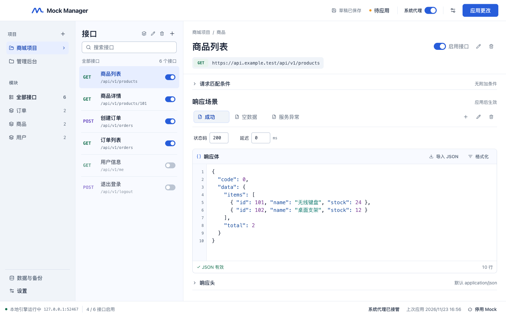

# Mock Manager

[English](README.md) · [源码](https://github.com/Josp3r/mock-manager) · [反馈问题](https://github.com/Josp3r/mock-manager/issues)

面向前端开发者的本地桌面 API Mock 管理器。保持原请求地址，快速切换成功、空数据、错误和延迟响应，无需修改业务代码。

通过 **项目 → 接口 → 响应场景** 管理 Mock。内置代理为匹配的请求返回选定的 JSON，其余请求继续访问原服务。浏览器或应用需要将请求发送到本地代理。



*截图为中文界面。应用同时支持简体中文和英语。*

## 功能与运行平台

- 按项目和模块组织接口，为同一个接口管理多个响应场景。
- 匹配原始 HTTP/HTTPS URL、请求方法，以及可选的 Query/Header 条件。
- 配置 JSON、状态码、响应头和延迟。
- 单独启停接口，或加载项目预设。
- 自动保存草稿，手动应用后改变代理响应。
- 管理 macOS 和 Windows 系统代理，在关闭或退出时恢复原配置。
- 项目、草稿和响应数据保存在本地，无需注册账户。

打包目标包括 **macOS 13+（Apple Silicon / Intel）** 和 **Windows 10/11 x64**。成品包含代理引擎，无需另外安装 Node.js、npm 或 `w2`。可按下方[从源码运行与打包](#从源码运行与打包)创建应用。

## 第一次使用

1. 打开 **Mock Manager.app**，内置引擎自动启动。点击左侧“设置”查看运行状态和地址。
2. HTTPS 接口：点击“导出根证书”，双击导出的 `.crt` 文件，添加到 macOS「登录」钥匙串；打开证书的「信任」选项，选择「始终信任」，Windows 上双击 `.crt`，选择「安装证书 → 当前用户」，放入「受信任的根证书颁发机构」。完成后重启浏览器。内置引擎已开启 HTTPS 解密；证书信任仍需手动完成。
3. 在顶栏或设置中开启“系统代理”。浏览器应使用系统代理，代理扩展可切为系统模式或停用。也可以按界面地址手动配置客户端。
4. 点击“测试连接”，验证本地 HTTP 请求经过内置代理。此测试不代表浏览器路由或 HTTPS 证书信任已配置。
5. 新建项目和接口，填写完整原始 URL 和 HTTP 方法，编辑成功、空数据、报错等响应场景。
6. 选择场景、启用接口，点击“应用更改”，再刷新目标页面。

初始示例使用 `api.example.test`，所有接口默认关闭。“已同步”表示规则已写入并通过读回验证，实际请求仍需经过正确代理。

本地构建采用 ad-hoc 签名，尚未进行 Apple 开发者签名和公证。若首次打开被阻止，可通过“系统设置 → 隐私与安全性”允许打开，或使用 Finder 的“打开”操作；无需关闭系统安全设置。Windows 构建尚未进行 Authenticode 签名。

## 切换语言

在 **设置 → 语言** 中选择“跟随系统”、“简体中文”或“English”。选择后立即生效，并在下次打开时保留。跟随系统时，优先匹配系统首选语言列表中的中文或英语；没有匹配项时使用英语。

语言偏好独立于 Mock 数据保存。切换界面语言不会重命名已有项目、接口或场景，不会改写 JSON，也不会应用待提交规则。新建的示例数据和默认场景名称使用创建时的当前语言。

## 日常管理

编辑自动保存为草稿，点击“应用更改”才改变代理响应。无效 JSON 草稿可以保存，但无法应用。删除或停用单个接口也需要重新应用。“停用 Mock”只停用本应用管理的规则，与系统代理开关相互独立。

项目预设记录各接口的启用状态和选中场景。加载预设会修改草稿，仍需点击应用。项目备份包含项目、接口、场景和预设；导入会创建新 ID，并默认停用接口。证书和系统代理状态不进入备份。

关闭 macOS 窗口后，引擎继续运行。macOS 真正退出应用（**⌘Q**）或关闭 Windows 应用时，先保存草稿、恢复本应用接管前的系统代理，再停止引擎。如果恢复被取消或遇到外部配置冲突，应用会保持运行。下次启动沿用已应用规则，系统代理需重新开启。

## 匹配方式与当前限制

| 支持项 | 当前行为 |
|---|---|
| 请求匹配 | 协议、域名、端口、路径和 HTTP 方法精确匹配 |
| Query / Header | 等值条件；多个条件必须全部满足 |
| 响应 | JSON 正文、自定义响应头、200–599 状态码 |
| 延迟 | 每个场景 0–60,000 ms |
| 组织方式 | 项目、模块、接口、场景、预设、JSON 备份 |
| 平台 | macOS arm64/x64、Windows x64；两种系统均提供代理开关 |

粘贴在 URL 中的 Query 会转换为匹配条件。界面暂不支持 `:id` 形式的路径参数、通配符/正则 URL 匹配、请求体匹配、响应脚本和云同步。

## 系统代理与恢复

macOS 开启时，应用保存当前网络位置的代理配置，将 HTTP/HTTPS 指向内置引擎，临时关闭 PAC、自动发现及 SOCKS，并保留绕过列表。macOS 可能要求授权。关闭开关或退出应用时恢复原配置；即使引擎已停止，也可执行恢复。

如果其他程序修改了这些设置，恢复会停止并提示，避免覆盖外部修改。可处理冲突后重试，或选择“保留当前设置 → 确认保留”结束接管；后者不修改系统当前设置，原配置备份仍保留。含 HTTP/HTTPS 认证元数据的原代理暂不支持接管。

Windows 管理当前用户的 Internet/WinINet LAN 代理，保存代理地址、绕过列表、PAC URL 与自动检测标志，将 HTTP/HTTPS 指向本地引擎，并在关闭或退出时恢复。机器级策略或锁定的配置会被拒绝接管；不修改 WinHTTP、VPN 专用或应用自行配置的代理。

系统代理只影响遵循系统设置的应用。应用不读取或写入钥匙串密码，也不自动信任根证书。

“恢复专属规则”恢复上次成功应用的规则和响应文件，保留当前草稿；未应用的更改仍需手动应用。不要手工编辑内置引擎的专属规则或已应用响应文件。

默认数据目录为：

```text
macOS:   ~/Library/Application Support/Whistle Mock Manager/
Windows: %APPDATA%\Whistle Mock Manager\
```

保留旧目录名是为了兼容升级。目录中包含草稿、恢复副本、响应 fixtures、语言偏好和内置引擎的 `proxy-engine/` 数据。可通过设置中的“打开数据目录”定位。异常退出后，代理恢复信息会保留至下次启动。

## 从旧版本升级

退出旧版后再打开新版，避免单实例锁将启动请求交给旧版。0.2.0 增加 Intel Mac 和 Windows 打包支持，保留原应用标识、数据目录和语言选择；已有项目与内置引擎证书可继续使用。

所有用户统一使用内置引擎，旧 `w2` 连接不再读取；外部 Whistle 进程和规则不会被改动。从外部引擎版本升级时，重新应用草稿或恢复上次快照，并配置内置引擎的新证书和地址。若系统代理仍指向旧地址，先关闭开关恢复，再重新开启。

已分配的内置端口若被其他程序占用，释放占用后点击“重试启动”；应用不会接管未知服务。

## 从源码运行与打包

使用 Node.js **22.12+** 和 npm；编译 macOS Swift 系统代理助手还需要 **Xcode Command Line Tools**；Windows 使用系统自带的 **Windows PowerShell 5.1**。请在目标操作系统上构建。

```sh
git clone https://github.com/Josp3r/mock-manager.git
cd mock-manager
npm ci --legacy-peer-deps
npm run dev
```

版本由锁文件固定。`--legacy-peer-deps` 用于绕过 npm 10 处理测试工具可选 peer 依赖时的解析问题。

按目标架构构建：

```sh
# macOS
npm run package:mac:arm64
npm run package:mac:x64
# Windows x64
npm run package:win
```

Intel 成品位于 `release/mac/Mock Manager.app`，Windows 位于 `release/win-unpacked/Mock Manager.exe`。验证解包应用后，执行 `npm run archive:release -- --platform darwin --arch arm64` 生成发布文件；Intel 改为 `--arch x64`，Windows 使用 `--platform win32 --arch x64`。Windows 产物包含 NSIS 安装器和便携 ZIP，产物及 SHA-256 校验文件写入 `release/`。

GitHub Actions 会在各自原生环境构建并测试三个目标。Push/PR 产生可下载的构建产物；推送与版本号一致的 `v*` 标签后，只有三个目标全部通过，才会创建包含附件的 **Release 草稿**，由维护者检查后发布。

成品位于 `release/mac-arm64/Mock Manager.app`。打包脚本会进行并验证本地 ad-hoc 签名，不包含 Apple Developer ID 签名或公证。

## 验证

```sh
npm test
npm run typecheck
npm run build
npm run test:integration
npm run test:engine
npm run test:desktop
npm run test:system-proxy:desktop
npm run test:i18n:desktop
node --import tsx scripts/design-preview.mjs
npm run package:mac
npm run test:packaged -- "release/mac-arm64/Mock Manager.app"
```

代理集成测试使用固定版本的 Whistle 和本地测试后端，不访问正式接口。桌面测试使用隔离数据目录；系统代理交互测试通过模拟助手执行，不改变真实代理或证书信任。打包成品测试会通过真实原生助手执行只读状态检查。Windows 原生代理写入测试只允许在一次性 CI 机器上显式运行，并在 finally 中恢复配置，不应在个人电脑执行。原有桌面模拟助手脚本仍用于 macOS；三个原生 CI 目标均运行跨平台的成品测试。

开发时，`MOCK_MANAGER_DATA_DIR=/absolute/path` 可指定测试数据目录，`MOCK_MANAGER_PROXY_HELPER` 可覆盖测试助手。打包成品忽略这两个测试变量；可使用 Electron 的 `--user-data-dir=<绝对路径>` 参数建立隔离配置。

## 实现与许可证

应用使用 Electron、React、TypeScript 和 Vite。内置 Whistle **2.10.15** npm 包在 Electron utility process 中运行，使用独立数据、证书和持久化端口，仅监听 `127.0.0.1`。管理请求带每次启动新生成的认证密钥。

Mock Manager 使用 [MIT 许可证](LICENSE)。Whistle 同样使用 MIT；原始许可证及声明见 [THIRD-PARTY-NOTICES.txt](THIRD-PARTY-NOTICES.txt)，也可从应用菜单“帮助 → 开源许可证”打开。依赖包许可证保留在成品中。
